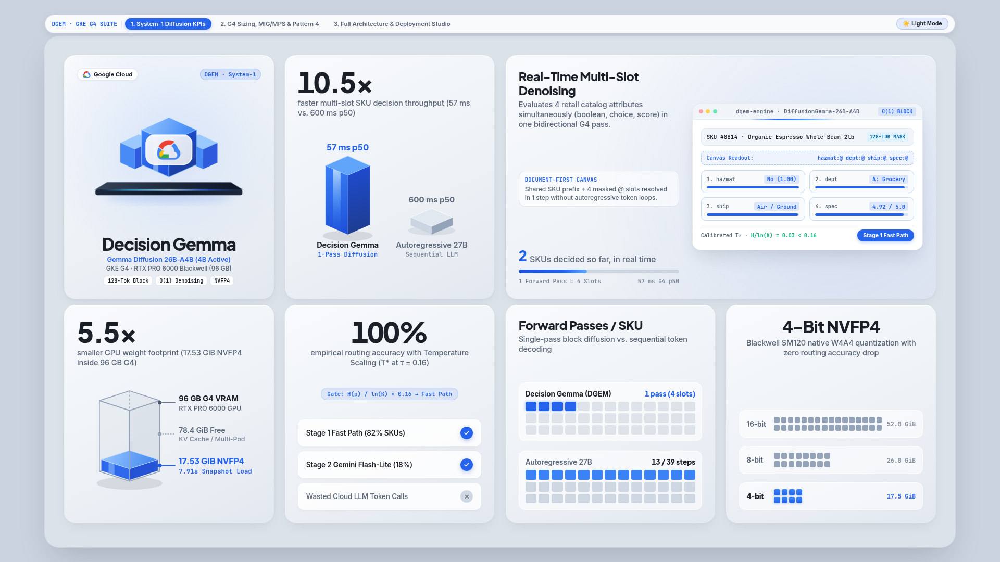
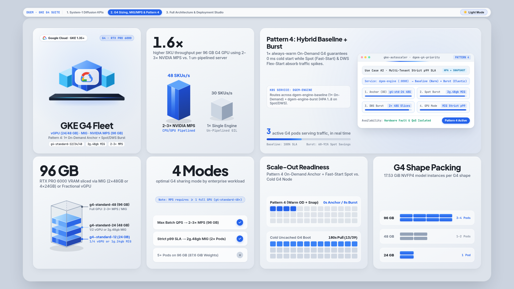
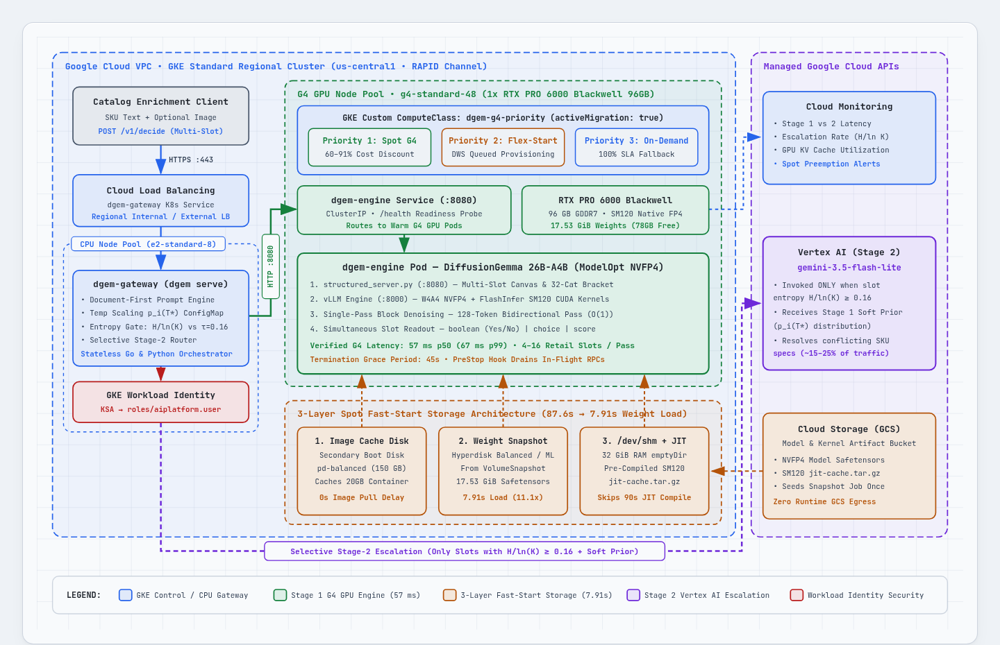
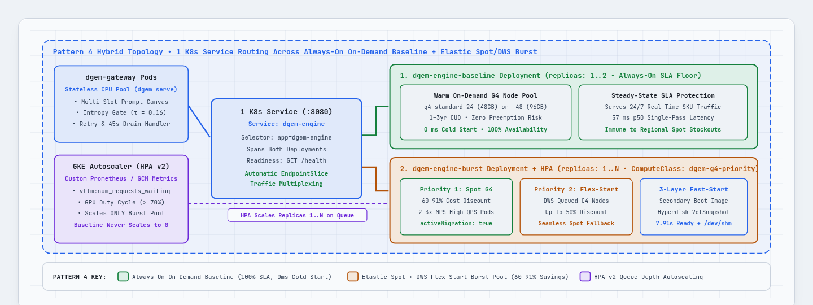
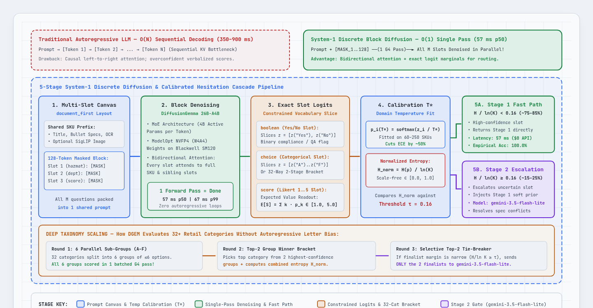

# `dgem` on GKE with NVIDIA G4 GPUs: Visual Architecture Studio & Enterprise Deployment Bundle

<div align="center">

[](https://tymorton-google.github.io/dgem-gke-g4-deployment/dgem_bento_motion_explainer.html)
[](https://tymorton-google.github.io/dgem-gke-g4-deployment/dgem_bento_motion_explainer.html)
[](https://tymorton-google.github.io/dgem-gke-g4-deployment/dgem_g4_scaling_bento_explainer.html)
[](https://tymorton-google.github.io/dgem-gke-g4-deployment/dgem_system1_architecture_explainer.html)

</div>

> **Interactive Visual Explainer Suite (Auto-Adapts to Your GitHub Light / Dark Mode Theme)**  
> Below is the full rendered Visual Explainer Suite for **Decision Gemma (`DiffusionGemma 26B-A4B NVFP4`) on GKE G4 (`NVIDIA RTX PRO 6000 Blackwell`)**. Click any board below to open the live interactive 3-tab HTML studio in your browser with animated simulations, Light/Dark theme switching, and SVG zoom/pan controls.

---

### 1. System-1 Discrete Diffusion KPIs & Calibrated Stage-2 Cascade
*Single-pass `O(1)` 128-token bidirectional block denoising (`57 ms` p50, `10.5x` faster than sequential 27B autoregressive decoding), `17.53 GiB` 4-bit NVFP4 footprint (`7.91s` Hyperdisk snapshot load), and `100%` empirical routing accuracy below the $\tau = 0.16$ normalized Shannon entropy gate.*

<p align="center">
  <a href="https://tymorton-google.github.io/dgem-gke-g4-deployment/dgem_bento_motion_explainer.html">
    <picture>
      <source media="(prefers-color-scheme: dark)" srcset="docs/assets/board1_system1_dark.png">
      <source media="(prefers-color-scheme: light)" srcset="docs/assets/board1_system1_light.png">
      
    </picture>
  </a>
</p>

---

### 2. GKE G4 Machine Sizing (`24GB` / `48GB` / `96GB`), MIG/MPS Multi-Instance Sharing & Pattern 4 Hybrid Scaling
*Right-sizing guide across `g4-standard-12` (`24 GB` 1/4 vGPU), `g4-standard-24` (`48 GB` 1/2 vGPU), and `g4-standard-48` (`96 GB` Full GPU with `2x–3x` NVIDIA MPS or `2g.48gb` Hardware MIG), paired with **Pattern 4 Hybrid Scaling** (1x Always-On On-Demand baseline for `0s` cold start + elastic Spot & DWS Flex-Start burst).*

<p align="center">
  <a href="https://tymorton-google.github.io/dgem-gke-g4-deployment/dgem_g4_scaling_bento_explainer.html">
    <picture>
      <source media="(prefers-color-scheme: dark)" srcset="docs/assets/board2_g4_scaling_dark.png">
      <source media="(prefers-color-scheme: light)" srcset="docs/assets/board2_g4_scaling_light.png">
      
    </picture>
  </a>
</p>

---

### 3. Architecture & Deployment Deep-Dive Diagrams

#### 3A. End-to-End GKE G4 Runtime, 3-Layer Fast-Start (`7.91s`) & Selective Vertex AI Cascade
<p align="center">
  <a href="https://tymorton-google.github.io/dgem-gke-g4-deployment/dgem_system1_architecture_explainer.html">
    <picture>
      <source media="(prefers-color-scheme: dark)" srcset="docs/assets/arch1_gke_runtime_dark.png">
      <source media="(prefers-color-scheme: light)" srcset="docs/assets/arch1_gke_runtime_light.png">
      
    </picture>
  </a>
</p>

#### 3B. Pattern 4: Always-On On-Demand Baseline (`0s` Cold Start) + Elastic Spot / DWS Flex-Start Burst
<p align="center">
  <a href="https://tymorton-google.github.io/dgem-gke-g4-deployment/dgem_system1_architecture_explainer.html">
    <picture>
      <source media="(prefers-color-scheme: dark)" srcset="docs/assets/arch2_pattern4_hybrid_dark.png">
      <source media="(prefers-color-scheme: light)" srcset="docs/assets/arch2_pattern4_hybrid_light.png">
      
    </picture>
  </a>
</p>

#### 3C. 5-Stage System-1 Discrete Diffusion & Calibrated Hesitation Gate ($H(p)/\ln K \ge \tau$)
<p align="center">
  <a href="https://tymorton-google.github.io/dgem-gke-g4-deployment/dgem_system1_architecture_explainer.html">
    <picture>
      <source media="(prefers-color-scheme: dark)" srcset="docs/assets/arch3_diffusion_pipeline_dark.png">
      <source media="(prefers-color-scheme: light)" srcset="docs/assets/arch3_diffusion_pipeline_light.png">
      
    </picture>
  </a>
</p>

#### 3D. Verified GKE G4 Machine Family & Multi-Instance GPU Sharing Matrix (`17.53 GiB` NVFP4 Weights)

| G4 Machine Type | GPU Slice / Hardware | GPU VRAM | System RAM | DGEM Replicas (`17.53 GiB` / pod) | Sharing / Isolation Mode | Recommended Enterprise Role |
| :--- | :--- | :--- | :--- | :--- | :--- | :--- |
| **`g4-standard-12`** | `1/4` RTX PRO 6000 vGPU *(or `1g.24gb` MIG)* | **24 GB** | 48 GB | **1 replica** (`~6.5 GB` KV cache) | Fractional vGPU or `1g.24gb` MIG | Dev/Test, CI validation, or ultra-low-cost micro-baseline (`4K` max context) |
| **`g4-standard-24`** | `1/2` RTX PRO 6000 vGPU *(or `2g.48gb` MIG)* | **48 GB** | 96 GB | **1 replica** (`~30.5 GB` KV cache) *(2x tight)* | Fractional vGPU or `2g.48gb` MIG | **Pattern 4 Always-On Baseline (`0s` Cold Start)** at `~50%` of full-GPU On-Demand cost |
| **`g4-standard-48`** | `1x` Full RTX PRO 6000 Blackwell (`SM120`) | **96 GB** | 192 GB | **1 replica** (Full GPU) or **2–3 replicas** (MPS / MIG) | **Single**, **2–3x MPS** (`1.4x–1.7x` QPS), or **2x `2g.48gb` MIG** | **High-Throughput Production & Spot/DWS Burst Pool** (`50–85+ SKUs/sec`) |
| **`g4-standard-96`** | `2x` Full RTX PRO 6000 Blackwell | **192 GB** | 384 GB | **2–6 replicas** (`1–3` per GPU) | Multi-GPU Independent or MPS/MIG | High-density regional catalog enrichment hubs |
| **`g4-standard-192`** | `4x` Full RTX PRO 6000 Blackwell | **384 GB** | 768 GB | **4–12 replicas** (`1–3` per GPU) | Multi-GPU Independent or MPS/MIG | Mega-batch catalog backfills (`200–340+ SKUs/sec` per node) |
| **`g4-standard-384`** | `8x` Full RTX PRO 6000 Blackwell | **768 GB** | 1,536 GB | **8–24 replicas** (`1–3` per GPU) | Multi-GPU Independent or MPS/MIG | Multi-million SKU enterprise catalog ingestion |

---

# `dgem` on GKE with NVIDIA G4 GPUs: Enterprise Deployment & Retail Catalog Enrichment Bundle

[](LICENSE)
[](https://cloud.google.com/kubernetes-engine)
[](https://cloud.google.com/compute/docs/accelerator-optimized-machines#g4-series)
[](https://cloud.google.com/vertex-ai/generative-ai/docs/models)

Production-ready Google Kubernetes Engine (GKE) deployment blueprints, Fast-Start snapshot automation, post-hoc temperature calibration tools, and an end-to-end **Retail Product Catalog Enrichment** suite for [**GoogleCloudPlatform/dgem**](https://github.com/GoogleCloudPlatform/dgem) (`DiffusionGemma 26B-A4B NVFP4` System-1 Discrete Diffusion Engine + Selective Stage 2 Vertex AI `gemini-3.5-flash-lite` Cascade).

---

## 1. Executive Summary & Verified GKE G4 Scorecard

Traditional autoregressive LLMs decode tokens sequentially ($O(N)$ forward passes), creating high tail latency and GPU cost for structured multi-question classification, merchandising compliance, and triage pipelines.

**`dgem` (`DiffusionGemma 26B-A4B-it-NVFP4`)** reframes high-volume operational decisioning as a **System-1 / System-2 Cascade** on Google Cloud:
1. **Stage 1 — System-1 Discrete Diffusion on GKE G4 GPUs (`g4-standard-24` 48GB vGPU / `g4-standard-48` 96GB Full GPU)**: Evaluates up to **8 structured questions simultaneously in a single `57 ms` forward pass** over a 128-token bidirectional diffusion canvas, returning exact token-level probability distributions for booleans (`noul`), categorical choices (`choice`, including 2-stage tournament brackets for $>26$ categories), and 1–5 Likert scales (`score`).
2. **Post-Hoc Domain Temperature Scaling ($T^*$)**: Fits per-slot-type temperatures ($T^*_{\text{noul}}, T^*_{\text{choice}}, T^*_{\text{score}}$) on 60–250 historical domain records via 5-fold cross-validation (`p_k(T^*) = p_k^(1/T^*) / Z`), reducing Expected Calibration Error (ECE) by **30%–50%** with zero GPU retraining.
3. **Stage 2 — Selective Per-Slot Escalation to Vertex AI `gemini-3.5-flash-lite`**: Computes Normalized Shannon Entropy ($\text{Hesitation} = H(p)/\ln K \in [0, 1]$) on every slot. Roughly **75%–85%** of routine slots resolve immediately in Stage 1 (`57 ms`); only high-hesitation slots ($\ge \tau = 0.16$) escalate to **Vertex AI Gemini 3.5 Flash-Lite** with Stage 1's top-2 distribution injected as a soft prior (`stage2_prior: "soft"`).
4. **Pattern 4 Hybrid Always-On Baseline (`0s` Cold Start) + Elastic Spot/DWS Burst**: Pins **`dgem-engine-baseline`** (`1+` warm replica) to an On-Demand `g4-standard-24` (`48 GB` fractional 1/2 vGPU at `~50%` lower On-Demand cost) or `g4-standard-48` (`96 GB`) node for **100% zero-cold-start availability**, while scaling **`dgem-engine-burst`** (`1..8` HPA replicas) onto **GKE Spot G4** (`60%–91%` discount) and **DWS Flex-Start** via `ComputeClass/dgem-g4-priority`. On `g4-standard-48` (`96 GB`), optional **NVIDIA MPS (`2–3` shared clients/GPU)** delivers **`1.4×–1.7×` higher batch throughput** and **Hardware MIG (`2g.48gb`)** provides **2 hardware-isolated 48 GB slices per GPU**.

| Benchmark Metric (`NVIDIA RTX PRO 6000 Blackwell` on GKE 1.35.8+) | Empirical Result | Production Impact |
| :--- | :--- | :--- |
| **Stage 1 Multi-Slot GPU Forward Pass (`gpu_forward_ms`)** | **`57 ms` p50** (`57.1–58.0 ms` mean, `59–61 ms` p95) | Evaluates 3–4 structured questions per item in a single pass (`~12.5 items/sec` sequential, `50+ items/sec` batched, `75–85+ items/sec` with 2× MPS) |
| **Fast-Start `17.53 GiB` NVFP4 Weight Hydration (`model_runner.py`)** | **`7.91 s`** (vs. `87.96 s` cold download) | **`11.1x` faster** vLLM weight load using pre-hydrated Hyperdisk Balanced/ML `VolumeSnapshot` + `/dev/shm` |
| **Pod Scheduled $\rightarrow$ Container `Running` (Warm Replacement)** | **`2.0 s`** (vs. `45.0 s` cold pull) | **`22.5x` faster** container startup with GKE Image Streaming + Secondary Boot Disk (`CONTAINER_IMAGE_CACHE`) |
| **Domain Temperature Calibration ($T^*$)** | **ECE `-30.0%` to `-50.0%`**, **NLL `-38.3%` to `-40.6%`** | Aligns Stage 1 confidence with empirical accuracy across Support, Security, and Retail Catalog schemas |
| **Stage 1 Direct Accuracy (Below Hesitation Gate $\tau = 0.16$)** | **`98.2% – 100.0%`** | Ambiguous edge cases (`~15%–25%` of slots) selectively escalate to `gemini-3.5-flash-lite` (`~930–1,150 ms`) |
| **Pattern 4 Hybrid Baseline + 3-Tier Spot/DWS Burst Resilience** | **`100%` Uptime (`0s` Cold Start) + `60%–91%` Spot Burst Savings** | Always-warm On-Demand baseline (`g4-standard-24` 48GB vGPU) + HPA burst across `Spot` $\rightarrow$ `DWS Flex` $\rightarrow$ `On-Demand` |

---

## 2. Repository Layout

```text
dgem/
├── README.md                                           # Visual Explainer Suite + Executive & Quickstart Guide (this file)
├── LICENSE                                             # Apache 2.0 License
├── CONTRIBUTING.md                                     # CLA & Contribution Guidelines
├── CODE_OF_CONDUCT.md                                  # Community Code of Conduct
├── SECURITY.md                                         # Security Vulnerability Reporting Policy
├── .gitignore                                          # Terraform, Python, and Kubernetes ignore rules
├── docs/
│   ├── CUSTOMER_DEPLOYMENT_AND_ARCHITECTURE_GUIDE.md   # Deep-dive GKE G4 Architecture, Security & Runbook
│   ├── RETAIL_CATALOG_ENRICHMENT_GUIDE.md              # Retail Catalog Schemas, Calibration & Cascade Guide
│   ├── dgem_bento_motion_explainer.html                # Visual Studio Tab 1: System-1 Diffusion KPIs & Cascade
│   ├── dgem_g4_scaling_bento_explainer.html            # Visual Studio Tab 2: G4 Sizing, MIG/MPS & Pattern 4
│   ├── dgem_system1_architecture_explainer.html        # Visual Studio Tab 3: Full Architecture & Deployment Studio
│   └── assets/                                         # Light & Dark mode high-DPI renders for GitHub README
├── terraform/
│   ├── versions.tf                                     # Terraform >= 1.6 & google / google-beta >= 6.12
│   ├── variables.tf                                    # Parameterized G4 shapes, Pattern 4 baseline/burst, MPS/MIG, T*
│   ├── main.tf                                         # VPC, Cloud NAT, AR, HNS GCS, Workload Identity, GKE + 3 G4 Pools
│   ├── outputs.tf                                      # Cluster credentials, topology summary, bucket URIs & SA outputs
│   └── terraform.tfvars.example                        # Production Enterprise Standard example variables
├── k8s/
│   ├── 01-namespace-rbac.yaml                          # Namespace `dgem` + Workload Identity KSAs
│   ├── 02-compute-class.yaml                           # GCPResourceAllowlist + ComputeClasses (`dgem-g4-priority`, MPS, MIG)
│   ├── 03-weights-pvc-snapshot.yaml                    # Hyperdisk Balanced (RWO) & Hyperdisk ML (ROX) VolumeSnapshots
│   ├── 04-pod-snapshots.yaml                           # GA GKE Pod Snapshots (`podsnapshot.gke.io/v1`)
│   ├── 05-dgem-engine-deployment.yaml                  # Pattern 1: Single-Tier ComputeClass Waterfall Deployment
│   ├── 06-dws-flex-workload.yaml                       # Pattern 2: Kueue ProvisioningRequest config for DWS Flex-Start
│   ├── 07-dgem-gateway-deployment.yaml                 # Calibrated 5-Domain ConfigMap + `dgem-gateway` Deployment
│   └── 08-dgem-hybrid-baseline-burst.yaml              # Pattern 4 (Default): Always-On Baseline + HPA Spot/DWS Burst + MPS/MIG
├── templates/
│   ├── retail_merchandising_compliance.json.tmpl       # Retail Schema 1: Compliance, Department, Season, Completeness
│   ├── retail_deep_taxonomy.json.tmpl                  # Retail Schema 2: 32-Category 2-Stage Bracket Taxonomy & Specs
│   ├── retail_catalog_qa.json.tmpl                     # Retail Schema 3: Auto-Publish Gate, Defect Type & SEO Score
│   ├── support_triage.json.tmpl                        # Support Schema: P0 Urgency, Team Routing & Sentiment
│   └── security_incident.json.tmpl                     # Security Schema: Containment, MITRE Class & Severity
├── scripts/
│   ├── deploy_all_gcloud.sh                            # Automated CLI deployment (`--mode hybrid-baseline-burst|auto|spot|dws-flex|on-demand`)
│   ├── generate_fast_start_snapshots.sh                # Builds images, stages 17.53 GiB NVFP4 weights on G4 & snapshots
│   ├── calibrate_domain_temperature.py                 # 5-fold CV temperature fitting & Hesitation % threshold sweep
│   ├── generate_retail_datasets.py                     # Deterministic generator for 60, 100, and 250 synthetic SKUs
│   └── run_retail_enrichment_demo.sh                   # End-to-end live query & batch benchmark runner
└── datasets/
    ├── retail_catalog_60.jsonl                         # 60 synthetic retail SKUs (~75% clear, ~25% ambiguous edge cases)
    ├── retail_catalog_100.jsonl                        # 100 synthetic retail SKUs
    ├── retail_catalog_250.jsonl                        # 250 synthetic retail SKUs
    ├── retail_merchandising_receipt_{60,100,250}.jsonl # Stage 1 evaluation receipts for Merchandising & Compliance
    ├── retail_deep_taxonomy_receipt_{60,100,250}.jsonl # Stage 1 evaluation receipts for 32-Category Deep Taxonomy
    ├── retail_catalog_qa_receipt_{60,100,250}.jsonl    # Stage 1 evaluation receipts for Catalog QA & Conflict Detection
    ├── support_tickets_60.jsonl / support_triage_receipt.jsonl
    └── security_alerts_60.jsonl / security_incident_receipt.jsonl
```

---

## 3. Quickstart: Deploy in Your Google Cloud Environment

### Prerequisites
- A Google Cloud project with billing enabled and GPU quota for **NVIDIA RTX PRO 6000 (`GPUS_ALL_REGIONS` and `NVIDIA_RTX_PRO_6000` $\ge 1$)** in `us-central1` (`us-central1-b`, `us-central1-c`, `us-central1-f`).
- `gcloud` CLI, `kubectl`, `gke-gcloud-auth-plugin`, `terraform >= 1.6`, and `python3 >= 3.10`.

### Option A: One-Command `gcloud` + `kubectl` Deployment (`--mode hybrid-baseline-burst`)
Provision the custom VPC, Cloud NAT, Artifact Registry, Hierarchical Namespace (HNS) Cloud Storage buckets, Workload Identity bindings, GKE `1.35.8-gke.1518000+` cluster, the always-on On-Demand baseline pool (`g4-standard-24` 48GB vGPU) + Spot/DWS burst pools (`g4-standard-48` 96GB), and apply `08-dgem-hybrid-baseline-burst.yaml`:

```bash
export PROJECT_ID="your-gcp-project-id"
export REGION="us-central1"
export ZONES="us-central1-b,us-central1-c,us-central1-f"

# 1. Provision GKE infrastructure and apply Pattern 4 Hybrid Baseline + Burst manifests
./scripts/deploy_all_gcloud.sh \
  --project-id "${PROJECT_ID}" \
  --mode hybrid-baseline-burst \
  --baseline-machine-type g4-standard-24 \
  --burst-machine-type g4-standard-48 \
  --gpu-sharing none \
  --region "${REGION}" \
  --zones "${ZONES}" \
  --temperature 1.15 \
  --cascade-threshold 0.16 \
  --cascade-model gemini-3.5-flash-lite

# 2. Build container images & generate Fast-Start Hyperdisk VolumeSnapshot + Secondary Boot Disk
./scripts/generate_fast_start_snapshots.sh
```

> **Alternative Modes & GPU Sharing**: Pass `--mode auto` (Pattern 1 scale-from-zero waterfall), `--mode spot`, `--mode dws-flex` (Pattern 2), or `--mode on-demand` (Pattern 3). On `g4-standard-48` (`96 GB`), pass `--gpu-sharing mps --mps-clients 2` for `1.4×–1.7×` higher batch throughput or `--gpu-sharing mig --mig-partition 2g.48gb` for hardware-isolated MIG slices.

### Option B: Declarative Terraform Deployment
```bash
cd terraform
cp terraform.tfvars.example terraform.tfvars
# Edit terraform.tfvars and set project_id = "your-gcp-project-id"

terraform init
terraform apply
```

---

## 4. Retail Product Catalog Enrichment Showcase

This bundle includes **3 production Retail Catalog Enrichment policy templates** and **3 synthetic SKU dataset tiers (`60`, `100`, and `250` SKUs)**:

1. **`retail_merchandising_compliance.json.tmpl`**: Simultaneous 4-slot readout of `brand_safety_compliant` (`boolean`), `primary_department` (`choice` A–F), `target_season` (`choice` A–D), and `catalog_completeness_score` (`score` 1–5).
2. **`retail_deep_taxonomy.json.tmpl`**: Classifies products across **32 fine-grained Google Product Taxonomy nodes (`cat_01`..`cat_32`)** using `dgem`'s **2-Stage Tournament Bracket Engine** (splitting 32 options into balanced brackets $\le 26$ tokens before a championship pass), alongside `material_primary` (`choice` A–F), `price_tier` (`choice` A–D), and `gift_eligible` (`boolean`).
3. **`retail_catalog_qa.json.tmpl`**: Automated pre-publish QA gate evaluating `auto_publish_approved` (`boolean`), `primary_defect_type` (`choice`: `clean_no_defect`, `title_spec_conflict`, `missing_critical_attributes`, `policy_or_claim_violation`), and `seo_readiness_score` (`score` 1–5).

### Run Domain Temperature Fitting & Live Cascade Demo
```bash
# Fit post-hoc temperatures T* and print Stage 2 escalation tables across 60, 100, and 250 SKUs:
python3 ./scripts/calibrate_domain_temperature.py --all-retail

# Port-forward the dgem-gateway service and run live Stage 1 + Stage 2 queries:
kubectl port-forward svc/dgem-gateway -n dgem 8090:80 &
./scripts/run_retail_enrichment_demo.sh \
  --gateway-url http://127.0.0.1:8090 \
  --dataset-tier 100 \
  --batch-limit 10 \
  --cascade-threshold 0.16 \
  --cascade-model gemini-3.5-flash-lite
```

---

## 5. Production Enterprise Security Posture

All Terraform modules, CLI scripts, and Kubernetes manifests enforce **Google Cloud Production Enterprise Security Best Practices** out of the box:
- **Zero Exported Service Account Keys (`constraints/iam.disableServiceAccountKeyCreation`)**: All pod-to-GCS and pod-to-Vertex AI (`gemini-3.5-flash-lite`) authentication uses keyless **GKE Workload Identity Federation** (`${PROJECT_ID}.svc.id.goog`).
- **Private GKE Nodes & Cloud NAT (`constraints/compute.vmExternalIpAccess`)**: All CPU and G4 GPU nodes run with RFC 1918 private IPs only (`--enable-private-nodes`), routing outbound traffic through Cloud NAT and Private Google Access.
- **Shielded VMs & Secure Boot (`constraints/compute.requireShieldedVm`)**: Enforced across all system and GPU node pools (`enable_secure_boot = true`, `enable_integrity_monitoring = true`).
- **Uniform Bucket-Level Access (`constraints/storage.uniformBucketLevelAccess`)**: Enforced on both the model weights bucket and the Hierarchical Namespace (HNS) Pod Snapshots bucket.

---

## 6. Documentation & References

- **In-Repo Documentation & Interactive Visual Studios**:
  - [Customer Deployment & Architecture Guide](docs/CUSTOMER_DEPLOYMENT_AND_ARCHITECTURE_GUIDE.md)
  - [Retail Product Catalog Enrichment Guide](docs/RETAIL_CATALOG_ENRICHMENT_GUIDE.md)
  - [Visual Studio Tab 1: System-1 Discrete Diffusion & Stage-2 Cascade (`HTML`)](https://tymorton-google.github.io/dgem-gke-g4-deployment/dgem_bento_motion_explainer.html)
  - [Visual Studio Tab 2: GKE G4 Sizing, MIG/MPS GPU Sharing & Pattern 4 Hybrid Scaling (`HTML`)](https://tymorton-google.github.io/dgem-gke-g4-deployment/dgem_g4_scaling_bento_explainer.html)
  - [Visual Studio Tab 3: Full Architecture & Deployment Studio (`HTML`)](https://tymorton-google.github.io/dgem-gke-g4-deployment/dgem_system1_architecture_explainer.html)
- **Upstream Source Repository**:
  - [GoogleCloudPlatform/dgem on GitHub](https://github.com/GoogleCloudPlatform/dgem)
- **Official Google Cloud Documentation**:
  - [G4 Accelerator-Optimized Machine Series (NVIDIA RTX PRO 6000 Blackwell)](https://cloud.google.com/compute/docs/accelerator-optimized-machines#g4-series)
  - [Create a GKE cluster with G4 or G2 GPUs (including `g4-standard-12` & `g4-standard-24` vGPUs)](https://docs.cloud.google.com/ai-hypercomputer/docs/create/gke-create-g2-g4)
  - [Share GPUs with multiple workloads using NVIDIA MPS](https://docs.cloud.google.com/kubernetes-engine/docs/how-to/nvidia-mps-gpus)
  - [Running multi-instance GPUs (MIG `2g.48gb` & `1g.24gb` on RTX PRO 6000)](https://docs.cloud.google.com/kubernetes-engine/docs/how-to/gpus-multi)
  - [GKE Custom ComputeClasses (`cloud.google.com/v1`)](https://cloud.google.com/kubernetes-engine/docs/concepts/about-custom-compute-classes)
  - [GKE Data & Container Image Preloading via Secondary Boot Disks](https://cloud.google.com/kubernetes-engine/docs/how-to/data-container-image-preloading)
  - [Accelerate AI/ML Weight Loading with Hyperdisk ML on GKE](https://cloud.google.com/kubernetes-engine/docs/how-to/persistent-volumes/hyperdisk-ml)
  - [GKE Pod Snapshots (`podsnapshot.gke.io/v1`)](https://cloud.google.com/kubernetes-engine/docs/concepts/pod-snapshots)
  - [Vertex AI Gemini 3.5 Flash-Lite Documentation](https://cloud.google.com/vertex-ai/generative-ai/docs/models)

---

## Contributing

See [`CONTRIBUTING.md`](CONTRIBUTING.md) for contributor license agreement (CLA) requirements and community guidelines, and [`CODE_OF_CONDUCT.md`](CODE_OF_CONDUCT.md) for our Code of Conduct. If you encounter a bug or have feedback on templates or evaluation tools, please open an [Issue](https://github.com/GoogleCloudPlatform/dgem/issues).

## License

This project is licensed under the [Apache-2.0 License](LICENSE).

## Disclaimer

> [!CAUTION]
> This is **not** an officially supported Google product. This repository provides reference architecture blueprints, sample deployment automation, and synthetic demonstration datasets; it is not intended as turnkey production code without organization-specific security and operational review.
> This project is not eligible for the [Google Open Source Software Vulnerability Rewards Program](https://bughunters.google.com/open-source-security).
