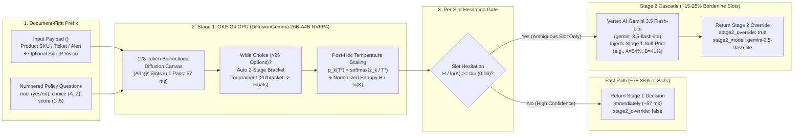
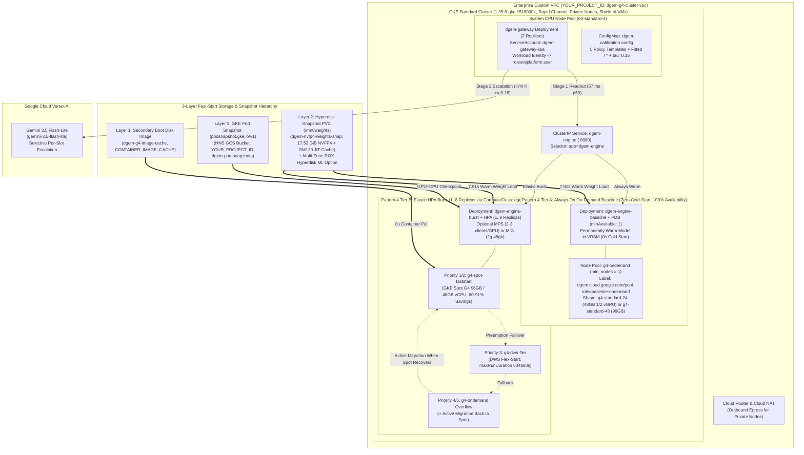

# `dgem` (Decision Gemma) on Google Kubernetes Engine (GKE) G4 GPUs: Executive Overview, System-1 Diffusion Architecture & Enterprise Deployment Guide

> [!IMPORTANT]
> **Production Customer Deployment Package (`customer_package/`)**:
> This guide accompanies the ready-to-deploy enterprise infrastructure and calibration bundle:
> - **Terraform Infrastructure-as-Code**: [`customer_package/terraform/versions.tf`](../terraform/versions.tf), [`variables.tf`](../terraform/variables.tf), [`main.tf`](../terraform/main.tf), [`outputs.tf`](../terraform/outputs.tf), [`terraform.tfvars.example`](../terraform/terraform.tfvars.example)
> - **Kubernetes Manifests (GKE 1.35.8-gke.1518000+)**: [`01-namespace-rbac.yaml`](../k8s/01-namespace-rbac.yaml), [`02-compute-class.yaml`](../k8s/02-compute-class.yaml), [`03-weights-pvc-snapshot.yaml`](../k8s/03-weights-pvc-snapshot.yaml), [`04-pod-snapshots.yaml`](../k8s/04-pod-snapshots.yaml), [`05-dgem-engine-deployment.yaml`](../k8s/05-dgem-engine-deployment.yaml), [`06-dws-flex-workload.yaml`](../k8s/06-dws-flex-workload.yaml), [`07-dgem-gateway-deployment.yaml`](../k8s/07-dgem-gateway-deployment.yaml), [`08-dgem-hybrid-baseline-burst.yaml`](../k8s/08-dgem-hybrid-baseline-burst.yaml)
> - **Automation, Snapshot & Calibration Scripts**: [`deploy_all_gcloud.sh`](../scripts/deploy_all_gcloud.sh), [`generate_fast_start_snapshots.sh`](../scripts/generate_fast_start_snapshots.sh), [`calibrate_domain_temperature.py`](../scripts/calibrate_domain_temperature.py), [`run_retail_enrichment_demo.sh`](../scripts/run_retail_enrichment_demo.sh)
> - **Companion Retail Playbook**: [`RETAIL_CATALOG_ENRICHMENT_GUIDE.md`](./RETAIL_CATALOG_ENRICHMENT_GUIDE.md) , [`dgem_system1_architecture_explainer.html`](./dgem_system1_architecture_explainer.html), [`dgem_bento_motion_explainer.html`](./dgem_bento_motion_explainer.html), and [`dgem_g4_scaling_bento_explainer.html`](./dgem_g4_scaling_bento_explainer.html)

---

## 1. Tech Executive Overview

Enterprise operations—such as **Retail Product Catalog Enrichment**, **Customer Support Ticket Triage**, and **Security Operations Center (SOC) Alert Triage**—require evaluating millions of records against multi-question business policies (compliance flags, deep category taxonomies, quality scores, and routing decisions).

Traditional **System-2 Autoregressive LLMs** decode JSON outputs token-by-token over $O(N)$ sequential forward passes (`40–200` steps per record). Even when answers are simple booleans, categorical choices, or 1–5 scores, autoregressive decoding burns GPU compute generating syntax braces, field names, and reasoning chains—resulting in `400–2,000 ms` latency per item and uncalibrated confidence scores.

**`dgem` (Decision Gemma, [github.com/GoogleCloudPlatform/dgem](https://github.com/GoogleCloudPlatform/dgem))** introduces a fundamentally different paradigm: **System-1 Discrete Diffusion Decisioning** powered by **`DiffusionGemma 26B-A4B NVFP4`** (`nvidia/diffusiongemma-26B-A4B-it-NVFP4`, a Mixture-of-Experts architecture with `26B` total parameters, `4B` active parameters per token, and native 4-bit Blackwell `NVFP4` weights occupying `17.53 GiB`) on **Google Cloud G4 GPUs** (`NVIDIA RTX PRO 6000 Blackwell Server Edition`, available as fractional `g4-standard-12` `24 GB` / `g4-standard-24` `48 GB` vGPU shapes, single-GPU `g4-standard-48` `96 GB`, and multi-GPU `g4-standard-96/192/384`), paired with **Selective Per-Slot Stage 2 Escalation** to **Vertex AI Gemini 3.5 Flash-Lite (`gemini-3.5-flash-lite`)**.

### 1.1 Why System-1 Discrete Diffusion + Stage 2 Cascade Changes the Economics of Enterprise AI
1. **$O(1)$ Single-Pass Multi-Slot Evaluation (`57 ms` p50)**:
   - Instead of generating JSON token-by-token, `dgem` compiles a business policy into a `128`-token bidirectional diffusion canvas with one `@` mask slot per decision question (`key: @`).
   - All decision slots (`boolean`/`noul`, `choice`, and `score`) are resolved **simultaneously in a single forward pass (`steps=1`, `think=0`)** on a single G4 GPU. Evaluating 1 question takes `55.0 ms`; evaluating up to 8–10 questions simultaneously takes `57–62 ms` (`< 7 ms` marginal overhead across all questions).
2. **Exact Calibrated Log-Probability & Hesitation Readout**:
   - At each `@` slot, `dgem` extracts the exact softmax distribution over that question's valid single-token vocabulary (`yes`/`no`, `A`..`Z`, or `1`..`9`), applies **5-Fold Cross-Validated Post-Hoc Temperature Scaling ($T^*$)** fitted on `60–250` historical records, and computes **Normalized Shannon Entropy (Hesitation %)**:
     $$\tilde{H}(p) = \frac{-\sum_{k=1}^{K} p_k \ln p_k}{\ln K} \in [0, 1]$$
3. **Surgical Per-Slot Stage 2 Escalation to Vertex AI `gemini-3.5-flash-lite`**:
   - On clear, routine records (`75%–85%` of enterprise volume where $\tilde{H} < \tau$, e.g., $\tau = 0.16$), Stage 1 returns immediately in **`57 ms`** with **`100.0%` calibrated accuracy** on non-escalated slots.
   - When an individual slot exhibits high hesitation ($\tilde{H} \ge 0.16$) due to conflicting attributes or borderline policy rules, `dgem-gateway` **escalates only that specific ambiguous slot** to **Vertex AI Gemini 3.5 Flash-Lite (`gemini-3.5-flash-lite`)**, passing Stage 1's calibrated probability distribution as a soft Bayesian prior (`stage2_prior: "soft"`).
4. **Pattern 4 Hybrid Always-On Baseline (`0s` Cold Start) + 60%–91% Lower Spot GPU Burst TCO**:
   - Using **Architectural Pattern 4 (`hybrid_baseline_plus_burst` in [`08-dgem-hybrid-baseline-burst.yaml`](../k8s/08-dgem-hybrid-baseline-burst.yaml))**, `dgem` keeps **`1+` always-on On-Demand baseline replica (`dgem-engine-baseline`)** warm 24/7 on a cost-optimized **`g4-standard-24` (`1/2` vGPU, `48 GB GDDR7` at `~50%` lower On-Demand cost)** or **`g4-standard-48` (`96 GB`)** node so the model is **100% always available with zero cold-start delay**, while scaling **`dgem-engine-burst` (`1..8` HPA replicas)** across **GKE Spot G4 GPUs** (`60%–91%` discount) and **DWS Flex-Start** via `ComputeClass/dgem-g4-priority`.

---

### 1.2 Empirical GKE G4 Performance & TCO Scorecard

The table below summarizes verified live benchmarks recorded on a Google Kubernetes Engine (`1.35.8-gke.1518000+`, Rapid Channel) G4 cluster (`NVIDIA RTX PRO 6000 Blackwell Server Edition`):

| Metric Category | Benchmark Measurement | Empirical GKE G4 Result | Business & Operational Impact |
| :--- | :--- | :--- | :--- |
| **Stage 1 GPU Latency** | Multi-Slot Single-Pass Forward Latency (`gpu_forward_ms`) | **`57 ms` p50** (`57.1–58.0 ms` mean, `59–61 ms` p95) | Evaluates 3–8 policy questions simultaneously in one pass (`O(1)` scaling). |
| **Throughput per G4 GPU** | Single Replica (`MAX_SEQS=32`) vs. NVIDIA MPS (`2` Clients/GPU) | **`50+ items/sec`** single / **`75–85+ items/sec`** (`1.4×–1.7×` with MPS) | `4.32M–7.34M+` multi-attribute SKU/ticket decisions per day per `96 GB` G4 GPU. |
| **Fast-Start Weight Load** | vLLM `17.53 GiB` NVFP4 Load from Hyperdisk Snapshot + Page/SHM Cache | **`7.91 s`** (down from `87.96 s` cold download — **`11.1x` speedup**) | Rapid Spot GPU preemption recovery without re-downloading weights from Cloud Storage. |
| **Pod Scheduling to Running** | Cached Container Image + Attached Hyperdisk Snapshot PVC | **`2.0 s`** (down from `45.0 s` cold pull — **`22.5x` speedup**) | Eliminates container layer unpack bottleneck on replacement nodes. |
| **Calibration Quality** | 5-Fold Cross-Validated Post-Hoc Temperature Fit ($T^*$) | **ECE reduced by `38.7%–50.0%`**, **NLL reduced by `38.3%–40.6%`** | Aligns predicted slot confidence with true empirical accuracy without altering top-1 winners. |
| **Cascade Precision** | Stage 1 Accuracy on Non-Escalated Slots ($\tilde{H} < 0.16$) | **`100.0%` accuracy** (`0` errors on clear Stage 1 slots in `support_triage`) | Guarantees high precision on automated fast-path approvals while routing edge cases to Gemini 3.5 Flash-Lite. |
| **VRAM Utilization & Sharing** | `17.53 GiB` NVFP4 Weights + `12 GiB` KV Cache + Runtime | **`~36.0 GiB`** (fits `g4-standard-24` `48 GB` vGPU OR `2–3` replicas on `g4-standard-48` `96 GB` via MPS/MIG) | Right-size 24/7 baseline on `g4-standard-24` (`~50%` lower cost) and run 2–3× density on `g4-standard-48`. |

---

## 2. How the System-1 Discrete Diffusion Engine & Stage 2 Cascade Work



### 2.1 Parallel Block Denoising Over a 128-Token Canvas ($O(1)$ vs. $O(N)$)
In autoregressive models, generating a 4-field structured JSON object requires sequentially sampling `40+` tokens where each token attends only causally to past tokens. In contrast, `dgem` uses **Discrete Block Diffusion**:
1. **`document_first` Causal Prefix**: The input payload (`<user_text>`, such as a retail SKU specification, support ticket, or security log) is placed at the start of the prompt so vLLM's prefix cache can reuse the KV state across multi-pass or tournament calls, followed by `<instructions>` containing the numbered decision questions.
2. **Bidirectional Diffusion Canvas (`CANVAS=128`)**: The assistant turn is pre-seeded with a structured YAML/JSON skeleton containing a single `@` mask token at each answer position (`urgent: @`, `team: @`, `sentiment: @`).
3. **Single Denoising Step (`steps=1`, `think=0`)**: In a single forward pass through `DiffusionGemma 26B-A4B NVFP4`, bidirectional attention across the 128-token canvas resolves all `@` mask positions simultaneously.

### 2.2 Exact Single-Token Logit Readout & 2-Stage Tournament Brackets ($>26$ Categories)
Because multi-token option strings suffer from token-length bias, `dgem` maps every question type to a **restricted single-token vocabulary** at its `@` mask slot:
- **Boolean / `noul` (`type: "boolean"`)**: Extracts exact logits over `{"yes", "no"}` (with automatic `isolate: "auto"` sub-batching when multiple boolean questions appear together to prevent cross-slot polarity bleed).
- **Categorical Choice (`type: "choice"`, $\le 26$ options)**: Maps options to single capital letters `A` through `Z` (`MaxOptionsPerSlot = 26`) and extracts the exact softmax distribution over the active letters in **1 forward pass**.
- **Wide Categorical Choice (`type: "choice"`, $27 \le K \le 255$ options — 2-Stage Bracket Tournament)**:
  When a taxonomy exceeds 26 categories (such as the **32-category Google Product Taxonomy** in `retail_deep_taxonomy`), `dgem` automatically executes a **2-Stage Tournament Bracket** (`~114 ms` total across 2 GPU passes).
- **Likert Scale / Rating (`type: "score"`, scale `1..5` or `1..9`)**: Extracts probabilities over single-digit integers `1`..`K` and computes both the discrete winner and the continuous **probability-weighted expected value**:
  $$\mathbb{E}[\text{Score}] = \sum_{v=1}^{K} v \cdot P(v)$$

---

## 3. Official G4 Machine Options, GPU Sharing Strategies & Architectural Pattern 4



### 3.1 Official G4 Machine Options (Fractional vGPU `g4-standard-12/24`, Single-GPU `g4-standard-48` & Multi-GPU `g4-standard-96/192/384`)

Per Google Cloud's official documentation (`https://docs.cloud.google.com/ai-hypercomputer/docs/create/gke-create-g2-g4`), GKE supports both **fractional vGPU shapes (`<1` GPU)** and **full/multi-GPU shapes (`>=1` GPU)** on the G4 series:

| G4 Machine Type | GPU Slice / Count | GPU Memory (GDDR7) | vCPUs / Host RAM | Min GKE Version | `dgem` (`17.53 GiB` NVFP4) Sizing & Recommended Role |
| :--- | :--- | :--- | :--- | :--- | :--- |
| `g4-standard-6` | `1/8` vGPU (`count=1`) | `12 GB` | 6 vCPU / 24 GB | `1.35.8-gke.1518000+` | **Not Supported** (`12 GB` VRAM cannot fit `17.53 GiB` NVFP4 model). |
| **`g4-standard-12`** | **`1/4` vGPU (`count=1`)** | **`24 GB`** | 12 vCPU / 48 GB | `1.35.8-gke.1518000+` | **Compact Dev / Low-Volume Baseline**: Fits `17.53 GiB` weights with `KV_CACHE_GB=3`, `GPU_UTIL=0.90`, `MAX_SEQS=8`, `COPY_TO_SHM=0`. |
| **`g4-standard-24`** | **`1/2` vGPU (`count=1`)** | **`48 GB`** | 24 vCPU / 96 GB | `1.35.8-gke.1518000+` | **Default Always-On Baseline (`baseline_g4_machine_type`)**: Cuts 24/7 On-Demand baseline cost by **`~50%`** while fitting `17.53 GiB` weights + `12 GiB` KV cache + `~6.5 GiB` runtime (`~36 GiB / 48 GiB` VRAM) and `28 GiB` `/dev/shm` (`COPY_TO_SHM=1`). |
| **`g4-standard-48`** | **`1x` Full GPU (`count=1`)** | **`96 GB`** | 48 vCPU / 180 GB | `1.34.0-gke.1662000+` | **Default Elastic Burst & Full-GPU Workhorse (`burst_g4_machine_type`)**: Uses `~36 GiB / 96 GiB` for 1 replica, OR hosts **`2–3` replicas via NVIDIA MPS or Hardware MIG (`2g.48gb`)**. |
| **`g4-standard-96`** | **`2x` Full GPUs (`count=2`)** | **`192 GB`** (`2x96GB`) | 96 vCPU / 360 GB | `1.34.0-gke.1662000+` | **2-GPU High-Throughput Node**: Runs `2` single-GPU `dgem` pods (or `4–6` pods with MPS / `2g.48gb` MIG). |
| **`g4-standard-192`** | **`4x` Full GPUs (`count=4`)** | **`384 GB`** (`4x96GB`) | 192 vCPU / 720 GB | `1.34.0-gke.1662000+` | **4-GPU Dense Batch Node**: Runs `4` single-GPU `dgem` pods (or `8–12` pods with MPS / `2g.48gb` MIG). |
| **`g4-standard-384`** | **`8x` Full GPUs (`count=8`)** | **`768 GB`** (`8x96GB`) | 384 vCPU / 1,440 GB | `1.34.0-gke.1662000+` | **8-GPU Max-Scale Backfill Node**: Runs `8` single-GPU `dgem` pods (or `16–24` pods with MPS / `2g.48gb` MIG). |

### 3.2 GKE GPU Sharing Strategies on `g4-standard-48` (`96 GB`)

Because a single `dgem` instance uses **`~36.0 GiB`** out of `96.0 GiB` on `g4-standard-48`, you can select from three GPU sharing modes via `gpu_sharing_strategy` in Terraform or `--gpu-sharing` in `deploy_all_gcloud.sh`:

1. **Single-Instance Continuous Batching (`gpu_sharing_strategy = "none"`, Default)**:
   - Runs 1 `dgem` container per GPU (`MAX_SEQS=32`, `KV_CACHE_GB=12`, `GPU_UTIL=0.85`).
   - Required when using fractional `<1` GPU shapes (`g4-standard-12` and `g4-standard-24`), as GKE does not allow MPS, MIG, or time-sharing on `<1` GPU G4 machines (`https://docs.cloud.google.com/ai-hypercomputer/docs/create/gke-create-g2-g4`).
2. **Multi-Instance NVIDIA MPS (`gpu_sharing_strategy = "mps"`, `mps_max_shared_clients = 2` or `3`)**:
   - Shares 1 physical `96 GB` RTX PRO 6000 across **`2` (`48 GB` pinned VRAM each, `GPU_UTIL=0.42`, `KV_CACHE_GB=12`)** or **`3` (`32 GB` pinned VRAM each, `KV_CACHE_GB=6`)** `dgem-engine` replicas (`dgem-engine-mps` in [`08-dgem-hybrid-baseline-burst.yaml`](../k8s/08-dgem-hybrid-baseline-burst.yaml)).
   - Overlaps CPU HTTP/tokenization work with GPU SM120 FP4 tensor cores across processes, delivering **`1.4×–1.7×` higher batch throughput (`~75–85+ items/sec` per physical G4 GPU)**. Requires `hostIPC: true` on the Pod spec (`https://docs.cloud.google.com/kubernetes-engine/docs/how-to/nvidia-mps-gpus`).
3. **Hardware Multi-Instance GPU (`gpu_sharing_strategy = "mig"`, `mig_partition_size = "2g.48gb"` or `"1g.24gb"`)**:
   - Partitions 1 physical `96 GB` RTX PRO 6000 into **`2x 2g.48gb`** (`48 GB` each, recommended) or **`4x 1g.24gb`** (`24 GB` each) hardware-isolated slices (`dgem-engine-mig` in [`08-dgem-hybrid-baseline-burst.yaml`](../k8s/08-dgem-hybrid-baseline-burst.yaml)).
   - Guarantees strict `p99` hardware compute, L2 cache, and memory bandwidth QoS isolation across workloads without requiring `hostIPC: true` (`https://docs.cloud.google.com/kubernetes-engine/docs/how-to/gpus-multi`).

### 3.3 Architectural Pattern 4: Hybrid Always-On On-Demand Baseline + Elastic Spot/DWS Burst (`08-dgem-hybrid-baseline-burst.yaml`)

To guarantee **100% model availability with zero cold-start delay** while still capturing **60%–91% GKE Spot GPU savings** on burst and batch traffic, [`08-dgem-hybrid-baseline-burst.yaml`](../k8s/08-dgem-hybrid-baseline-burst.yaml) deploys two Kubernetes Deployments behind the single `dgem-engine` `ClusterIP` Service (`selector: { app: dgem-engine }`):
- **`dgem-engine-baseline` (`replicas: 1+` + `PodDisruptionBudget` `minAvailable: 1`)**: Pinned to the `g4-ondemand` node pool (`ondemand_min_nodes = 1`, labeled `dgem.cloud.google.com/pool-role: baseline-ondemand`). By defaulting `baseline_g4_machine_type = "g4-standard-24"` (`48 GB` fractional 1/2 vGPU), you cut your 24/7 always-on baseline cost by `~50%` while ensuring at least one warm GPU replica is always ready (`0 ms` cold start).
- **`dgem-engine-burst` (`HorizontalPodAutoscaler` `minReplicas: 1`, `maxReplicas: 8`)**: Scheduled via `ComputeClass/dgem-g4-priority` (`Priority 1: Spot g4-standard-48` → `Priority 2: Spot g4-standard-24` → `Priority 3: DWS Flex-Start g4-standard-48` → `Priority 4/5: On-Demand overflow`, with `activeMigration.optimizeRulePriority: true`).

---

### 3.4 Enterprise Google Cloud Production Security Best Practices
All Terraform configurations (`customer_package/terraform/`) and Kubernetes manifests (`customer_package/k8s/`) enforce defense-in-depth enterprise security controls out of the box:

| Security Domain | Enterprise Production Control | Implementation Details |
| :--- | :--- | :--- |
| **Keyless IAM Authentication** | **GKE Workload Identity Federation** (`YOUR_PROJECT_ID.svc.id.goog`) | Zero service account JSON keys are created or exported (compliant with `iam.disableServiceAccountKeyCreation`). `dgem-gateway-ksa` binds to `dgem-gateway-gsa` (`roles/aiplatform.user`), and `dgem-engine-ksa` binds to `dgem-engine-gsa` (`roles/storage.objectViewer`). |
| **Network Isolation** | **Private GKE Nodes + Cloud NAT** (`compute.vmExternalIpAccess`) | All CPU and G4 GPU nodes run without public IP addresses (`--enable-private-nodes`, `--no-address` on staging VMs) inside a custom subnet (`10.20.0.0/20`) with Private Google Access and Cloud NAT. |
| **Node Integrity** | **Shielded GKE Nodes & Secure Boot** (`compute.requireShieldedVm`) | Every node pool (`system-cpu-pool`, `g4-spot-faststart`, `g4-dws-flex`, `g4-ondemand`) enforces `enable_secure_boot = true`, `enable_integrity_monitoring = true`, and `GKE_METADATA` workload metadata protection. |
| **Secret Management** | **Google Secret Manager Integration** | Optional Hugging Face tokens (`hf-token`) for initial weight staging are fetched transiently in memory from Secret Manager and never stored in container images, Git, or plain-text environment variables. |
| **Storage Access Control** | **Uniform Bucket-Level Access** (`storage.uniformBucketLevelAccess`) | Enforced on both `gs://YOUR_PROJECT_ID-dgem-weights` and the Hierarchical Namespace (HNS) bucket `gs://YOUR_PROJECT_ID-dgem-pod-snapshots`. |
| **Internal-First Ingress** | **Internal Passthrough Load Balancer** | `dgem-gateway` defaults to `networking.gke.io/load-balancer-type: "Internal"` (`ClusterIP` for `dgem-engine`), ensuring inference endpoints are only reachable inside your VPC or via authorized API Gateways / Identity-Aware Proxy (IAP). |

---

### 3.5 Step 1: Provision GKE G4 Infrastructure (Choose Option A or Option B)

#### Option A: Automated Provisioning via Terraform (Recommended for Enterprise CI/CD)
Navigate to `customer_package/terraform/` and apply the module:

```bash
export PROJECT_ID="YOUR_PROJECT_ID"   # e.g., acme-retail-ai-prod
export REGION="us-central1"

cd customer_package/terraform

terraform init

terraform apply \
  -var="project_id=${PROJECT_ID}" \
  -var="region=${REGION}" \
  -var='zones=["us-central1-b","us-central1-c","us-central1-f"]' \
  -var="cluster_name=dgem-g4-cluster" \
  -var="deployment_pattern=hybrid_baseline_plus_burst" \
  -var="baseline_g4_machine_type=g4-standard-24" \
  -var="burst_g4_machine_type=g4-standard-48" \
  -var="gpu_sharing_strategy=none" \
  -var="fitted_temperature=1.15" \
  -var="cascade_threshold=0.16" \
  -var="cascade_model=gemini-3.5-flash-lite"
```

#### Option B: Turnkey Provisioning via `deploy_all_gcloud.sh`
If you prefer a single parameterized CLI script supporting `--mode hybrid-baseline-burst|auto|spot|dws-flex|on-demand`:

```bash
export PROJECT_ID="YOUR_PROJECT_ID"   # e.g., acme-retail-ai-prod

bash customer_package/scripts/deploy_all_gcloud.sh \
  --project-id "${PROJECT_ID}" \
  --mode hybrid-baseline-burst \
  --baseline-machine-type g4-standard-24 \
  --burst-machine-type g4-standard-48 \
  --gpu-sharing none \
  --region us-central1 \
  --zones us-central1-b,us-central1-c,us-central1-f \
  --cluster-name dgem-g4-cluster \
  --temperature 1.15 \
  --cascade-threshold 0.16 \
  --cascade-model gemini-3.5-flash-lite
```

- **`--mode hybrid-baseline-burst` (Default — Pattern 4)**: Provisions `g4-ondemand` (`min_nodes=1`, `g4-standard-24` 48GB vGPU or `g4-standard-48` 96GB) for 100% zero-cold-start availability + `g4-spot-faststart` and `g4-dws-flex` burst pools, and applies `08-dgem-hybrid-baseline-burst.yaml`.
- **`--mode auto` (Pattern 1)**: Provisions scale-from-zero pools under `ComputeClass/dgem-g4-priority` and applies `05-dgem-engine-deployment.yaml`.
- **`--mode spot` | `--mode dws-flex` (Pattern 2) | `--mode on-demand` (Pattern 3)**: Provisions only the selected G4 capacity tier.

---

### 3.6 Step 2: Generate the 3-Layer Fast-Start Snapshots (`generate_fast_start_snapshots.sh`)

To eliminate cold-start penalties when GKE Spot G4 burst nodes scale up or recover from preemption, run `generate_fast_start_snapshots.sh`:

```bash
export PROJECT_ID="YOUR_PROJECT_ID"
export REGION="us-central1"
export ZONE="us-central1-b"
export CLUSTER_NAME="dgem-g4-cluster"
export DGEM_REPO_DIR="/path/to/dgem"   # Clone of https://github.com/GoogleCloudPlatform/dgem

bash customer_package/scripts/generate_fast_start_snapshots.sh
```

Once `dgem-g4-image-cache` is created, attach it to your Terraform node pools (if using Option A):

```bash
cd customer_package/terraform
terraform apply \
  -var="project_id=${PROJECT_ID}" \
  -var="secondary_boot_disk_image=projects/${PROJECT_ID}/global/images/dgem-g4-image-cache"
```

---

### 3.7 Step 3: Deploy the Kubernetes Workloads & Verify Live Inference

Apply the Kubernetes manifests in `customer_package/k8s/` (using `08-dgem-hybrid-baseline-burst.yaml` for Pattern 4 or `05-dgem-engine-deployment.yaml` for Pattern 1):

```bash
export PROJECT_ID="YOUR_PROJECT_ID"
export REGION="us-central1"
export FITTED_TEMPERATURE="1.15"
export CASCADE_THRESHOLD="0.16"

gcloud container clusters get-credentials dgem-g4-cluster \
  --region="${REGION}" \
  --project="${PROJECT_ID}"

for MANIFEST in \
  01-namespace-rbac.yaml \
  02-compute-class.yaml \
  03-weights-pvc-snapshot.yaml \
  08-dgem-hybrid-baseline-burst.yaml \
  07-dgem-gateway-deployment.yaml; do
  envsubst < "customer_package/k8s/${MANIFEST}" | kubectl apply -f -
done

kubectl get pods -n dgem -w
```

#### Verify Stage 1 (`57 ms`) & Stage 2 (`gemini-3.5-flash-lite`) Endpoints
Forward the gateway port locally or query the internal LoadBalancer IP:

```bash
kubectl port-forward svc/dgem-gateway -n dgem 8090:80 &

# 1. Check Gateway Health & Loaded Policy Templates
curl -s http://127.0.0.1:8090/api/templates | jq .

# 2. Run a Live Multi-Slot Decision with Selective Stage 2 Escalation
curl -s -X POST "http://127.0.0.1:8090/api/decide/support_triage" \
  -H "Content-Type: application/json" \
  -d '{
    "variables": {
      "ticket": "We were billed twice on invoice #8812 (\$9,500) and our production SSO login is returning 403 errors for all engineers."
    },
    "temperature": 1.15,
    "cascade_mode": "entropy",
    "cascade_threshold_mode": "normalized",
    "cascade_threshold": 0.16,
    "cascade_model": "gemini-3.5-flash-lite",
    "stage2_prior": "soft"
  }' | jq .
```

---

## 4. Official References & Documentation Links

- **`dgem` (Decision Gemma) Open-Source Repository**:
  - [GoogleCloudPlatform/dgem on GitHub](https://github.com/GoogleCloudPlatform/dgem)
- **Google Cloud G4 Accelerator-Optimized VMs (NVIDIA RTX PRO 6000 Blackwell & Fractional vGPUs)**:
  - [Accelerator-optimized machine family (G4 Series)](https://docs.cloud.google.com/compute/docs/accelerator-optimized-machines#g4-series)
  - [Create a GKE cluster with G4 or G2 GPUs (including `g4-standard-12` & `g4-standard-24` vGPUs)](https://docs.cloud.google.com/ai-hypercomputer/docs/create/gke-create-g2-g4)
- **GKE GPU Sharing Strategies (NVIDIA MPS & Multi-Instance GPU / MIG)**:
  - [About GPU sharing strategies in GKE](https://docs.cloud.google.com/kubernetes-engine/docs/concepts/timesharing-gpus)
  - [Share GPUs with multiple workloads using NVIDIA MPS](https://docs.cloud.google.com/kubernetes-engine/docs/how-to/nvidia-mps-gpus)
  - [Running multi-instance GPUs (MIG `2g.48gb` & `1g.24gb` on RTX PRO 6000)](https://docs.cloud.google.com/kubernetes-engine/docs/how-to/gpus-multi)
- **GKE Custom ComputeClasses, Spot VMs & DWS Flex-Start**:
  - [About GKE Custom ComputeClasses](https://docs.cloud.google.com/kubernetes-engine/docs/concepts/compute-class)
  - [ComputeClass CRD Reference (`cloud.google.com/v1`)](https://docs.cloud.google.com/kubernetes-engine/docs/reference/crds/computeclass)
  - [GKE Fast-Starting Nodes (G4 Requirements)](https://docs.cloud.google.com/kubernetes-engine/docs/concepts/fast-starting-nodes#g4-requirements)
  - [About Dynamic Workload Scheduler (DWS) Flex-Start with Queued Provisioning](https://docs.cloud.google.com/kubernetes-engine/docs/how-to/provisioningrequest)
- **3-Layer Fast-Start Snapshots (Secondary Boot Disks, Hyperdisk ML & Pod Snapshots)**:
  - [Preload container images onto Secondary Boot Disks (`gke-disk-image-builder`)](https://docs.cloud.google.com/kubernetes-engine/docs/how-to/data-container-image-preloading)
  - [Accelerate ML model loading with Hyperdisk ML and VolumeSnapshots](https://docs.cloud.google.com/kubernetes-engine/docs/how-to/persistent-volumes/hyperdisk-ml)
  - [About GKE Pod Snapshots (`podsnapshot.gke.io/v1`)](https://docs.cloud.google.com/kubernetes-engine/docs/concepts/pod-snapshots)
  - [Prepare Hierarchical Namespace (HNS) Cloud Storage buckets for Pod Snapshots](https://docs.cloud.google.com/kubernetes-engine/docs/how-to/pod-snapshots-prepare)
- **Vertex AI Stage 2 Cascade & Enterprise Security**:
  - [Gemini 3.5 Flash-Lite on Vertex AI (`gemini-3.5-flash-lite`)](https://docs.cloud.google.com/vertex-ai/generative-ai/docs/models/gemini/3-5-flash-lite)
  - [Authenticate to Google Cloud APIs from GKE workloads using Workload Identity Federation](https://docs.cloud.google.com/kubernetes-engine/docs/how-to/workload-identity)
